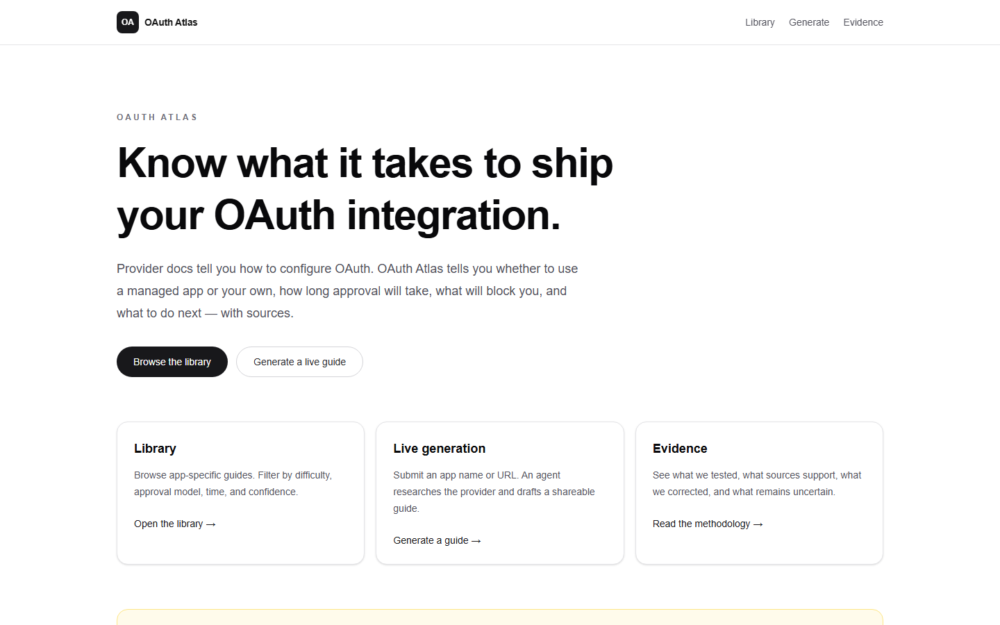
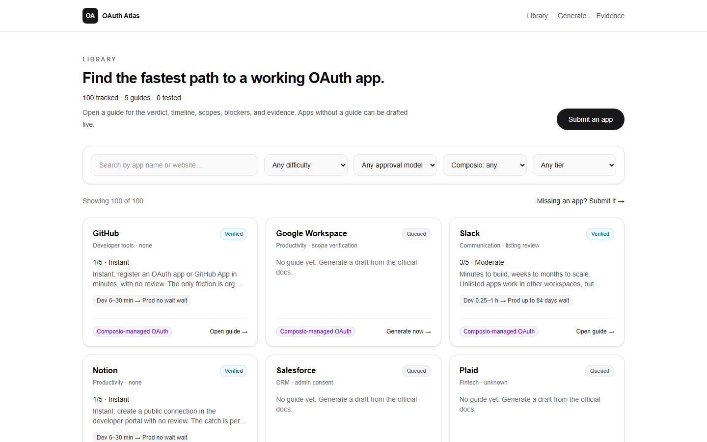
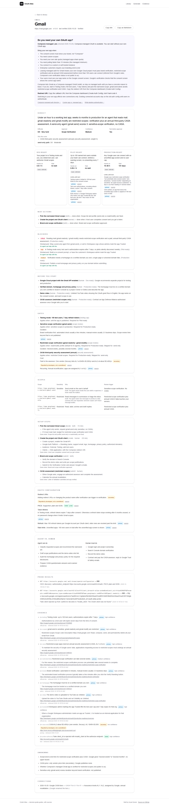
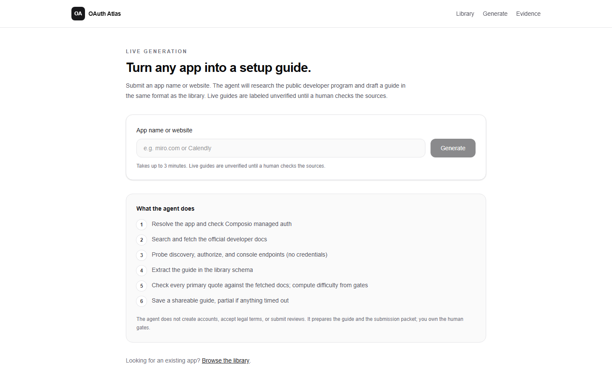
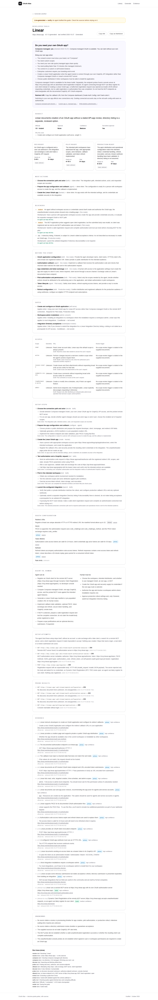

# OAuth Atlas

**Decision-grade OAuth setup and approval guides for developers building AI agents.**

Provider docs tell you how to configure OAuth. OAuth Atlas tells you whether you need your own OAuth app at all, how long approval will take, what will block you, and what to do next — with sources.

- **Live:** https://oauth-atlas.vercel.app
- **Repo:** https://github.com/Aryankumar29/oauth-atlas
- **Using it for your own app:** [`docs/USAGE.md`](docs/USAGE.md)
- **Built by:** Aryan Kumar ([@Aryankumar29](https://github.com/Aryankumar29))



## In my words

I built OAuth Atlas because the hard part of letting an AI agent act on a user's behalf is rarely the OAuth code. It is everything around it: do I even need my own OAuth app, which scopes will trigger a review, can I test with real users before approval, and is this an hour of work or six weeks of waiting? Today you piece that together from docs, forum threads and trial and error.

So each guide leads with the decision, not the documentation. It asks whether a managed app is enough, gives a difficulty score with its reason, and splits the path into three milestones with hands-on time and the wait you can't speed up. Then it says what to do next and who does it.

Three choices shape everything else:

- **The model reads; code decides.** A language model drafts the guide from official docs, but code checks every quote against the page it was fetched from and computes the difficulty from the provider's gates. A model never assigns a score, and it can never mark a claim as tested.
- **Evidence is per claim.** Each claim carries a source and a status (tested, primary, community, or inferred), and gaps are listed as unknowns instead of being filled in.
- **The agent tries the setup itself.** Without an account, it probes the provider's OAuth endpoints, attempts a code exchange, and looks for a remote MCP server where it can register its own client. Those findings change the guide. For Linear, I then ran the full setup for real: the agent registered itself, I approved the sign-in, and it called Linear's MCP server, with no developer console involved.

## Screenshots

| Library | Curated guide (Gmail) |
|---|---|
|  |  |
| **Live generation** | **Live-generated guide (Linear)** |
|  |  |

More in [`docs/screenshots/`](docs/screenshots/).

## Why this exists

A developer building an agent needs users to connect third-party apps. That means creating an OAuth app, configuring scopes and redirects, testing with users, and sometimes waiting weeks for provider review. The hard part is rarely the OAuth code. It is knowing:

- whether to use a managed OAuth app or create your own
- which scopes trigger review
- whether you can test before approval
- how much hands-on work is required
- how long the wait will be
- what will block launch
- what to do next

Today that answer is assembled from docs, blogs, forums, and trial and error. OAuth Atlas turns it into a shareable guide.

## What it does

1. **Library (`/apps`).** 100 tracked apps, searchable and filterable by difficulty, approval model, Composio-managed OAuth, and tier. Five have curated guides. The rest are queued, and each queued card links straight into live generation.
2. **Guide (`/apps/<slug>`).** Every guide opens with "Do you need your own OAuth app?", then gives a verdict and difficulty, three milestones (dev-ready → pilot-ready → production-ready), gates, scopes, the OAuth config, next actions, unknowns, and evidence. You can copy it as a link or as Markdown.
3. **Live generation (`/generate`).** Submit an app name or URL. An agent researches the provider, streams its steps, and saves a shareable guide at `/generate/<runId>`, labeled "Live-generated — verify."
4. **Evidence (`/evidence`).** How claims are checked, what the evidence statuses mean, the verification artifacts, and the current limitations.

### The five curated guides

| App | Difficulty (computed) | Why it's in the demo set |
|---|---|---|
| GitHub | 1 — Instant | Self-serve, no review; OAuth discovery metadata confirmed by probe |
| Notion | 1 — Instant | Public connection with no review; users grant access page by page |
| Slack | 3 — Moderate | Unlisted apps work, but history reads are throttled to 1 req/min until Marketplace approval |
| Gmail | 5 — Very hard (**send-only: 3**) | Restricted scopes mean verification plus annual CASA; `gmail.send` alone avoids CASA |
| Instagram | 4 — Hard | Business Verification plus App Review per permission; no official review SLA |

## How live generation works

`app/api/generate/route.ts` streams Server-Sent Events from `runPipeline` (`lib/agent/pipeline.ts`):

1. **Resolve.** Matches the query to the seed list in three tiers: exact name, slug, or alias first, then word-prefix, then substring. Substring matching applies only to queries of 3 or more characters; shorter queries resolve on an exact match only. A pasted URL matches the seed website host first, then the docs/console host, then the registrable domain. An ambiguous match is listed in the guide's unknowns, and so is a guessed website.
2. **Composio.** Checks whether the app is Composio-managed. Sources in order: the toolkit API (with `COMPOSIO_API_KEY`), the live managed-auth page, then the bundled snapshot `data/composio-managed.json`: 123 managed / 211 bring-your-own toolkits, snapshot 2026-10-20, from https://docs.composio.dev/toolkits/managed-auth.
3. **Discover** and **probe**, run concurrently:
   - **Discover:** a grounded LLM research call, then fetching official docs. A 403 gets a browser User-Agent retry, with the Jina Reader as a fallback. Login walls are detected.
   - **Probe:** credential-free requests (20 s cap) to the provider's discovery, authorize, and console endpoints.
   - **Attempt** (after the probe, 20 s cap; `lib/agent/attempt.ts`): the agent tries the setup steps it can take without an account, and nothing is created.
     - It exchanges a fake code at the token endpoint and reads the error. `code_verifier` demanded first means PKCE is required; HTTP 200 with an error body means errors are in the body.
     - It looks for a remote MCP server at `mcp.<official domain>` (RFC 9728, then RFC 8414 metadata).
     - Where client registration is advertised, it sends a registration request whose body is not JSON. A 400 with no credential demand means registration looks open, so an agent can likely register its own client with no developer console.
     - Code writes these as `tested` facts (`testKind: "attempt"`); the guide shows them under "Setup attempts". Results for 10 real apps: `docs/verification-log.md`.
4. **Extract.** A separate JSON-mode LLM call fills the Zod guide schema (`lib/schema.ts`). If the output doesn't validate, it is retried once; if it still fails, a labeled partial guide is saved instead.
5. **Verify** (`lib/agent/validate.ts`). Checks every claim:
   - A claim stays **primary** only if its source is on an **official host** for that app *and* its quote is found in the doc **fetched from that same URL**. If the quote is there but the host is off-domain (blogs, Composio docs), it becomes **secondary**. Otherwise it becomes **inferred**.
   - User-generated content on official domains is never primary: community and forum subdomains, Q&A and thread paths, Slack workspaces, and arbitrary GitHub repos.
   - `tested` needs a matching probe or attempt record. Probe and attempt facts (e.g. PKCE methods from a discovery document, or PKCE required by the token endpoint) are attached as `tested`.
   - **Difficulty is computed, never generated** (`lib/difficulty.ts`). It is the maximum weight of the gates required for production-ready (self-serve 1 … security assessment / partner program / no self-serve 5). Profile-specific gates (e.g. Gmail `send-only`) are skipped for that profile.
   - Generated guides never claim high confidence. They are `medium` only if they are complete with at least 3 primary evidence items; otherwise `low`.
6. **Render.** Saves `run:{id}` (30-day TTL) and `guide:{slug}`. A partial guide never overwrites a complete one.

**Deadlines.** At the 150 s soft deadline, discovery stops and extraction runs on what was fetched. The guide is marked **partial** and says so in its unknowns. Extraction has a 250 s hard cap. The route sets `maxDuration = 300`.

**Rate limit.** 5 live runs per IP per hour (HTTP 429 after that). Cache hits and mock runs don't count.

**Demo cache.** For the slugs in `DEMO_CACHE_SLUGS` (default `miro,calendly`), `/generate` serves the stored complete `guide:{slug}` instantly, marked "Cached demo guide". "Regenerate live" (`force=1`) runs the pipeline instead.

**Mock mode.** `MOCK_LLM=1` swaps in a mock LLM, recorded HTTP fixtures (unrecorded URLs return 404), and an in-memory store, so no network calls are made and no keys are needed. A `MOCK MODE` banner is shown. Mock runs never write to Redis.

**Providers.** Production runs on **Azure OpenAI** (deployment `gpt-6-sol`) through the OpenAI adapter: `LLM_PROVIDER=openai` with `OPENAI_BASE_URL` set to the Azure v1 endpoint; the web search tool and JSON output both work there. The code default is Anthropic (`claude-opus-5-5` with server-side web search, then a separate JSON extraction call). Gemini (`gemini-2.5-flash` with Google Search grounding) and OpenAI itself are also supported; override the model with `LLM_MODEL`. Settings for each: [`docs/USAGE.md`](docs/USAGE.md#4-self-hosting).

## Quickstart

```bash
npm ci
cp .env.example .env.local   # leave values empty; set MOCK_LLM=1 for offline mode
```

Offline, with no keys:

```bash
MOCK_LLM=1 npm run dev
```

With real keys, set `ANTHROPIC_API_KEY` (or another provider's key with `LLM_PROVIDER`) in `.env.local`. Upstash is optional locally; without it runs live in memory. Then run `npm run dev` and open `http://localhost:3000`.

Deploying (Vercel, env var owners, duration limits, cache warming, smoke checklist): see [`docs/deploy.md`](docs/deploy.md).

## Testing

```bash
npm run check      # typecheck && lint && vitest (264 tests) && validate:guides && next build
npm run test:e2e   # Playwright smoke on :3300 with MOCK_LLM=1 (first run: npx playwright install chromium)
```

Everything runs without API keys. Details are in [`docs/testing.md`](docs/testing.md).

## Batch library generation (T-007)

`scripts/generate-library.ts` runs the same pipeline over the queued seed apps. It writes `data/guides/<slug>.json` only for guides that pass the SPEC §12 QA gate (`qaGate` in `lib/agent/batch.ts`). The gate requires all of these:
- the guide is not partial
- at least 3 distinct sources, not counting the run's own probe URLs, and at least 1 primary source after validation
- at least one milestone limit is cited, and every gate that drives the difficulty score is cited
- the probe step ran
- the unknowns list is not empty
- every step has an owner

```bash
npx tsx scripts/generate-library.ts --dry-run --limit 3        # report only, writes nothing
npx tsx scripts/generate-library.ts --only miro,calendly        # write data/guides/<slug>.json for passing guides
```

- **Idempotent:** existing guide files are skipped unless you pass `--force`. Curated guides (hand-written, or tier `verified`/`tested`) are never overwritten, even with `--force`. `--limit` must be a positive integer.
- **Mock mode:** `MOCK_LLM=1` is refused without `--dry-run`, because mock output is never published.
- **Isolated store:** batch runs use a memory store, so they never touch the public `guide:{slug}` cache.
- **No auto-publish:** the script never edits `data/guides/index.ts` or the seed. It prints the import lines and the tier change for a human to apply after a spot check.
- **Keys:** real runs need the LLM keys exported in your shell, because `tsx` does not load `.env.local`.
- **Status:** on main, the library still has the 5 curated guides; no batch output has been committed.

## Key decisions

- **"Do you need your own OAuth app?" comes first.** Composio already manages OAuth for 123 toolkits (123 managed / 211 bring-your-own, snapshot 2026-10-20, [source](https://docs.composio.dev/toolkits/managed-auth)). Your own app (with its review path) becomes your problem only when you need your brand, custom scopes, or dedicated quota. Each guide says which case you're in.
- **Three milestones.** Dev-ready, pilot-ready, and production-ready each have hands-on hours, wait days, and the limits until the next milestone. Time to first test user is separate from time to public launch.
- **Difficulty is computed from gates**, not judged by an LLM. The scores for the curated guides are regression-tested.
- **Evidence is claim-level.** Statuses are tested / primary / secondary / inferred. Probes and the agent's own setup attempts are the only way to get `tested`.
- **Quality tiers over mass coverage.** 100 tracked apps, 5 curated guides, and live generation for the rest. We don't have 100 thin guides.
- **Provider-agnostic models.** One adapter interface for Anthropic, OpenAI (including Azure OpenAI) and Gemini; production uses Azure OpenAI.
- **Redis (Upstash) for runs and generated guides**, because Vercel's filesystem is read-only. The curated library is static JSON.
- **No token storage, accounts, or billing.** This is a guidance product, not an OAuth provider.

See `DECISIONS.md` for the full ADR log.

## Evidence summary

- Verification log: [`docs/verification-log.md`](docs/verification-log.md). Corrections: [`docs/corrections.md`](docs/corrections.md).
- Curated-guide sources were re-fetched on 2026-10-20 (T-006a), and every quote was string-matched against the fetched page.
- Corrections found during that pass:
  - **GitHub does publish OAuth discovery.** The root `/.well-known/openid-configuration` is 404, but RFC 8414 metadata lives at `github.com/.well-known/oauth-authorization-server/login/oauth`, and OIDC metadata at `github.com/login/oauth/.well-known/openid-configuration`. It is public preview and advertises PKCE S256. Probed: both returned 200.
  - **The Slack 2026-03-03 claim is unsourced.** The claim that the unlisted-app throttle was extended to existing installs on that date has no official source, so it is not in the guide. The throttle as documented applies to new unlisted apps and to new installs.
  - **The X Public Utility exception is unconfirmed.** X's pricing page confirms pay-per-use pricing with no subscriptions, but no longer mentions a Public Utility exception.
  - Also: GitHub allows up to 10 callback URLs and expires user tokens by default (8 h / 6 months); Notion's rate limit is 180/min (600/min on Business and Enterprise); Google CASA tiers are now AL1/AL2.

## Limitations

- **No completed provider approvals.** No paid accounts or production domains were used.
- **One real end-to-end setup, by choice** (T-015, `docs/verification-log.md`). I picked **Linear** as the worked example because it shows the path most relevant to agent builders: the agent registered its own client on Linear's MCP server, I approved the sign-in, and it called the server and revoked the token, with no developer console at all. For **GitHub**, creating an OAuth app was verified in the real console (instant, no review, Device Flow needs no client secret, token expiry on by default), but I did not run a full sign-in. **Notion** and the other providers rely on primary sources, probes and the automated setup attempts.
- **"Registration looks open" is confirmed only for Linear.** For other apps it rests on a 400 for a deliberately malformed registration body with no credential demand, so that evidence is rated `medium` confidence; Linear's is `high`.
- **Review timelines are community-sourced where providers publish none.** For example, Meta App Review "about 20 days" comes from community reports, and Business Verification "up to 14 business days" comes from a Meta business solution provider (360dialog). Both are labeled secondary.
- **Live guides are drafts** until a human checks the sources. They are labeled unverified and never rated high confidence.
- **Live difficulty can vary between runs.** The score is computed by code, but from gates the model extracts; whether a gate counts as required can differ run to run (two Linear runs scored 3 and 1, depending on whether workspace-admin access was tagged as required). Curated guides are fixed and regression-tested.
- **LLM quota.** Live runs depend on the provider's quota; at 5 runs/IP/hour, a long run may end as a labeled partial guide.
- Unverified items: see `docs/research.md` §6.4. These include the exact Composio BYO callback URL, the Microsoft Partner Center verification duration, LinkedIn partner timelines, Salesforce (JS-rendered) and Intuit (403) pages, and the "no self-serve" candidates.
- Open QA items (`docs/qa-report.md`), all P2:
  - **QA-10(2):** `github.com/<slug>` is treated as official for every app, with no ownership check.
  - **QA-12:** The `/thread/` and `/community/` UGC denylist could downgrade a real docs page with that path segment.
  - **QA-13 residual:** URL inputs now match the seed website host, then the docs/console host, then the registrable domain. The match ignores the path, so `www.microsoft.com/microsoft-teams` resolves to `microsoft`, with Teams listed as an alternative.
  - Accepted: no `server-only` guard (QA-3); unknown slugs return 200 with a not-found page (QA-5). QA-6 (`/evidence` repo links 404) is resolved now that the repo is public.
- Time estimates are ranges with a stated basis, not guarantees. This is not legal or compliance advice.

## Repository map

```
app/                  Routes: / , /apps, /apps/[slug], /generate, /generate/[runId], /evidence, /api/generate
components/           Library, guide view, generate client
lib/                  schema.ts, difficulty.ts, store.ts (Upstash/memory), agent/ (pipeline, resolve,
                      composio, discover, fetchDoc, probe, extract, validate, cache, llm/)
data/                 apps.seed.json (100), guides/*.json (5), composio-managed.json
scripts/              generate-library (T-007 batch), validate-guides, cache-guide, probe, snapshot-composio,
                      verify-mcp-setup + verify-github-device-flow (real setups), capture-screenshots
tests/, e2e/          Vitest unit + offline pipeline tests; Playwright smoke
docs/                 USAGE (start here to use it), deploy, testing, demo-script, verification log, corrections,
                      qa-report, research, evidence/ (setup records), screenshots/
```

## How I built it

I ran this like a small team with AI agents doing the building and me owning the product. I wrote the spec and the task board with acceptance criteria, made the product calls (decision first, computed difficulty, claim-level evidence, quality tiers over 100 thin guides), and handled everything that needs a person: provider accounts, consent screens, deploy approvals, and the real setups.

- **Claude Code (Opus 5.5):** lead builder, coordinating subagents for schema, pipeline, UI, guide research and release, one branch per task.
- **Fable 5.1:** an independent verifier that never reviewed its own code. It checked sources, red-teamed live generation, and drove fixes such as an SSRF hole and off-domain "primary" sources (`docs/qa-report.md`).
- **Grokbot:** backlog and merge-order coordination.

A branch merged only after the verifier approved it and `npm run check` passed. The repo is the source of truth: `SPEC.md`, `TASKS.md`, `STATUS.md`, `DECISIONS.md`.

— Aryan Kumar

## License

[MIT](LICENSE) © 2026 Aryan Kumar. The guides summarize public provider documentation with links to the sources; they are not legal or compliance advice.
